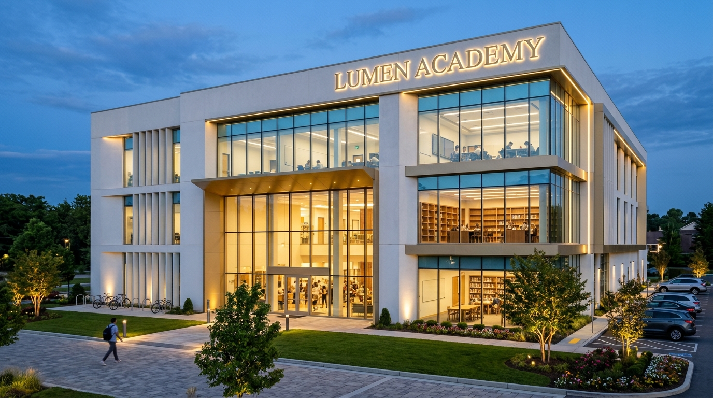
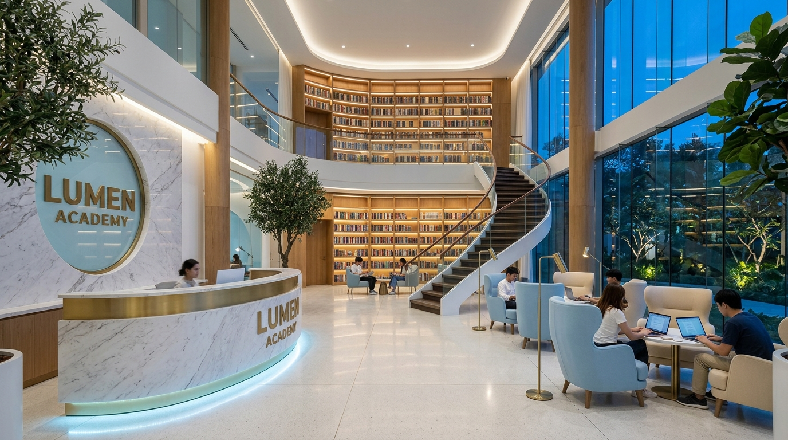
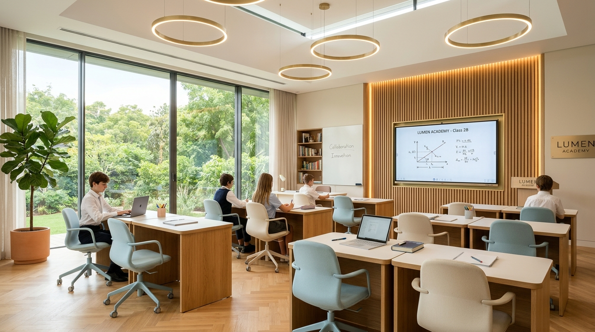
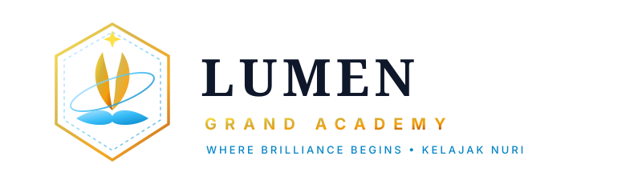

# 🏛️ LUMEN GRAND ACADEMY
### 3 Qavatli Zamonaviy va Innovatsion O'quv Markazi

> **Bosh shior:** *"Kelajagingiz nuri — Lumen bilan charog'on!"* / *"Where Brilliance Begins"*

---

## 🌟 Loyiha Haqida

**LUMEN GRAND ACADEMY** — bu oddiy darsxonalar emas, balki o'quvchilarda bir ko'rganda ilm olishga kuchli havas uyg'otuvchi, xalqaro andozalarga mos 3 qavatli zamonaviy ta'lim maskanidir.

* **Bino maydoni:** 3 qavat, 1,800 m²
* **Asosiy ranglar:** Kristall Oq (`#FFFFFF`), Och Moviy (`#38BDF8`), Aslzoda Oltin (`#D4AF37`)
* **Arxitektura:** Polgacha tushgan panoramik shisha derazalar, hashamatli 2 qavatli kutubxona, 3000K kechki fasad yoritish tizimi, yashil manzarali bog', velo va avtoturargoh.

---

## 📸 3D Renderlar Galereyasi

| 3D Fasad & Kechki Yoritish | 2 Qavatli Grand Kutubxona |
| :---: | :---: |
|  |  |

| Shinam Sinfxona | Vektor Logotip |
| :---: | :---: |
|  |  |

---

## 📐 3 Qavatli Bino Rejasi

### 🟡 1-QAVAT: "Welcome & Grand Knowledge Hub"
* **Grand Reception & Atrium Lounge:** Oq Calacatta marmari, och ko'k LED yoritish va oltin fasad logotipi. Ota-onalar va mehmonlar uchun qulay kutish joylari.
* **2 Qavatli Grand Kutubxona:** 10,000+ saralangan kitob fondi, shaxsiy shinam o'qish kabinalari (*Silent Focus Pods*), spiral zinalar va audio-kitob zonalari.
* **"Lumen Coffee & Lounge":** Dars oralig'ida dam olish va tetiklashish bufeti.
* **Diagnostika & Qabul xonalari:** Yangi o'quvchilar bilim darajasini aniqlash markazi.

### 🔵 2-QAVAT: "Language & Exact Sciences Floor"
* **Ingliz Tili (6 ta sinf):** Cambridge va IELTS 8.5+ dasturlari, akustik audio-tizimlar, erkin muloqot stollari.
* **Rus Tili (4 ta sinf):** Nutq madaniyati, grammatika va adabiy so'zlashuv xonalari.
* **Matematika & Mantiq (4 ta laboratoriya):** Prezident maktabi, Al-Xorazmiy olimpiadalari va SAT Math uchun interaktiv xonalar.
* **Dam olish orollari:** Tanaffusda o'quvchilar muloqot qiladigan shinam pufikli burchaklar.

### 🟢 3-QAVAT: "IT, Robotics & Future Tech Hub"
* **IT & Dasturlash Laboratoriyalari:** Python, Web, Mobile, Data Science va Sun'iy Intellekt (AI) uchun kuchli dual-monitorli kompyuterlar.
* **STEM & Robototexnika MakerSpace:** 3D printerlar, Arduino, mikrosxemalar va robotlar bellashuv maydoni.
* **Brainstorming Amfiteatri:** Taqdimotlar, pitching va xalqaro spikerlar uchun ko'p pog'onali yumshoq minbar.
* **Ochiq Yashil Osmon Terassasi (Sky Terrace):** Toza havoda kitob o'qish va qahva ichish uchun terassa.

---

## 🌳 Tashqi Hudud va Qulayliklar

* **Yashil Bog' va Gullar:** Yapon sarvlari, archalar, doimiy yashil maysazor va manzarali lavandazorlar.
* **Kechki Arxitekturaviy Yoritish:** Fasad bo'ylab issiq 3000K oltin LED chiziqlar, daraxt projektorlari va nurli 3D logotip.
* **Mobillik:** 20+ ta velosiped va elektr samokatlar uchun xavfsiz soyabonli zaryadlash stansiyasi.
* **Avtoturargoh:** 30+ o'rinli asfaltlangan, videokuzatuvli va avtomatik shlagbaumli parking.

---

## 🚀 Texnologiyalar

* HTML5 / Semantic Modern Architecture
* Tailwind CSS (v3 CDN)
* Lucide Icons
* Google Fonts (*Playfair Display*, *Outfit*, *Plus Jakarta Sans*)
* Responsive & Interactive Day/Night Mode Switcher
* SVG Vector Graphics

---

## 👤 Muallif

* **GitHub:** [@tabassumn0107](https://github.com/tabassumn0107)
* **Loyiha:** LUMEN GRAND ACADEMY
